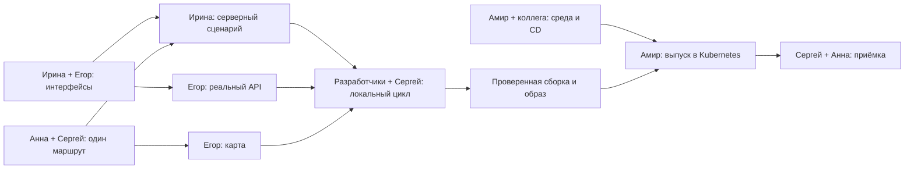

# ПУТЬ — вторая итерация и первый релиз в Kubernetes

**Рабочее окно: 10–16 ноября 2026. Цель выпуска: 16 ноября.** План подготовлен 10.11 после Sprint Review. Промежуточные даты, часы и способы реализации ниже — предложения для подтверждения владельцами. Прежний план Н2 на 05–11.11 заменён этим прогнозом, выполненные за 05–09.11 работы и часы пока не представлены.

[Итоги Н1 и аудит интеграции](ITERATION_1_REVIEW.md) · [Основной план](PUT_Project_Plan.md) · [Исторический план Н1](ITERATION_1.md).

**Цель:** пользователь проходит «предпочтения → рекомендации → маршрут на карте → выбор велосипеда → начало → завершение демонстрационной аренды» на реальных Frontend и Backend в предоставленном Kubernetes. Просмотр без аренды сохраняется. Приёмка не требует ручного изменения БД, сброса состояния или переключения mock между шагами.

## 1. Минимальный объём и условия прогноза

| Входит в релиз 16.11 | Остаётся после первого релиза |
|---|---|
| Один подготовленный маршрут Казани, один демонстрационный велосипед, существующий интерфейс | Расширение каталога до согласованного итогового объёма, покрытие всех трёх категорий |
| Реальный подбор по поддерживаемым предпочтениям и понятная пустая выдача. С одним маршрутом проверяем подходящий и неподходящий запрос | Более сложное ранжирование, новые фильтры |
| Геометрия на выбранной карте, просмотр без аренды, передача выбранного маршрута при начале | Полировка дизайна, фото, реальные отзывы и развитие избранного |
| Серверное состояние аренды, завершение, refresh, защита от повторов и конфликтов, сохранность после пересоздания Pod | Регистрация, платежи, реальная аренда, оборудование и внешние прокаты вообще не входят в учебный MVP |
| Kubernetes, доступный команде адрес, воспроизводимый выпуск, базовые проверки работоспособности и логи | Полная наблюдаемость, метрики/панель и итоговые доказательства курса — до защиты 27.11 |

Для первого релиза не требуется покрытие всех категорий одним маршрутом. Категории и длительность должны оставаться честными, неподходящий фильтр даёт пустой результат. Один велосипед — достаточный минимум, уже готовые дополнительные записи можно оставить, если они не увеличивают работу.

**Условия оценки:** Ирина предоставляет существующую основу Backend и оценивает оставшуюся реализацию в лимите I2-2. Общий CD и инфраструктурные шаблоны доступны для подключения, а не требуют самостоятельного создания платформы Амиром. Карта и одна геометрия готовы к локальному прогону. Сейчас эти условия не подтверждены полностью.

## 2. Бюджет команды

Все оценки — человеко-часы, включая совместные проверки. Время коллеги из другой команды сюда не включено и не считается доступным по умолчанию.

| Участник | Задачи ниже | Статусы и короткие согласования | Резерв исправлений | Всего |
|---|---:|---:|---:|---:|
| Ирина | 4.00 | 0.50 | 0.50 | **5.00** |
| Егор | 4.00 | 0.50 | 0.50 | **5.00** |
| Амир | 4.00 | 0.50 | 0.50 | **5.00** |
| Анна | 2.75 | 0.50 | 0.25 | **3.50** |
| Сергей | 3.75 | 0.50 | 0.25 | **4.50** |
| **Итого** | **18.50** | **2.50** | **2.00** | **23.00** |

Резерв не занят дополнительными функциями. Техническая сверка API входит в I2-1 и E2-1, время каждого учитывается отдельно. В совместных испытаниях разработчики отвечают за собственные части, Сергей — за протокол, Амир — за среду.

**Это лимит, а не доказательство достаточности.** Окно пересекает календарные недели 09–15 и 16–22.11. Амир до старта сверяет уже потраченные часы и доступность: ранее выполненная работа этой недели уменьшает оставшийся лимит 3–5 ч, а работа 16.11 уменьшает ресурс следующих задач. Старые 80 ч нельзя автоматически считать остатком. Новый план на 23 ч заменяет прежние 20 ч Н2, а не добавляется к ним. Доступность и остаток всего проекта пересчитываются в M2-1.

Для переносимости в GitHub Issues каждая строка имеет ID, одного владельца и критерий готовности. P0 — необходимое для релиза, P1 — полезное в пределах лимита. Статусы всех задач при составлении — «запланировано», фактическое выполнение уточняется у владельцев.

## 3. Задачи участников

### Ирина — Backend и серверные правила

| ID | Задача и ожидаемый результат | Приоритет | Часы | Зависимости | Критерий готовности |
|---|---|---|---:|---|---|
| I2-1 | Предоставить существующий Backend/решения и согласовать обмен с Егором | P0 | 0.50 | Её текущие материалы, E2-1 | Доступны repo/ветка или файлы, команда запуска, список готовых операций и остаточная оценка. Сверены поля, фильтры, ошибки, текущая аренда и режим пользователя. Повторное проектирование не требуется |
| I2-2 | Довести серверные операции для одного сценария и загрузку минимальных данных | P0 | 2.00 | I2-1, A2-2, S2-2. Согласование можно начать до готовой геометрии | Реальные подбор/деталь/велосипеды/текущая аренда/старт/завершение доступны. Маршрут связан с арендой, конфликт и повторы не создают дублей. Seed повторяем и не стирает аренды. Остаток сверх 2 ч сообщён сразу |
| I2-3 | Подготовить Backend к запуску и сохранению данных в среде | P0 | 0.75 | I2-1, M2-1 | Амиру переданы команда, порт, конфигурация, путь/способ хранения БД, порядок миграций, проверка готовности. Есть stdout/stderr с результатами запросов и аренды. Согласован способ консистентной копии/восстановления |
| I2-4 | Пройти локальную интеграцию и проверить серверные инварианты | P0 | 0.75 | I2-2/I2-3, E2-2. Совместный слот с S2-3 | В реальном обмене старт/финиш, refresh, повтор и конфликт дают согласованное состояние. Ирина устраняет серверные блокеры из своего резерва |

### Егор — Frontend, карта и интеграция

| ID | Задача и ожидаемый результат | Приоритет | Часы | Зависимости | Критерий готовности |
|---|---|---|---:|---|---|
| E2-1 | Сверить текущий API-клиент с ответами Ирины | P0 | 0.50 | I2-1, таблица в отчёте Н1 | Согласованы массивы/объекты, snake_case/camelCase, `любой`, пустая аренда, завершение без тела ответа и ошибки. Определён минимум адаптации клиента |
| E2-2 | Подключить реальный API и обеспечить восстановление аренды | P0 | 1.25 | E2-1, работающие операции I2-2 | `VITE_USE_MOCK=false`, реальные запросы подтверждены. Передаётся выбранный маршрут, refresh восстанавливает аренду. Ошибки восстановления видны, известную активную аренду можно завершить при сбое загрузки маршрута |
| E2-3 | Закрепить карту для релиза и отобразить подготовленный маршрут | P0 | 1.50 | A2-2, S2-2, домен из M2-1 | Выбор и условия записаны, линия/старт видны, координаты корректны. Для Яндекса есть работающий клиентский ключ с ограничениями. Карта проверена на адресе выпуска, доступность внешнего сервиса подтверждена |
| E2-4 | Пройти локальный сценарий, передать настройки production-сборки | P0 | 0.75 | E2-2/E2-3. Совместный слот с I2-4/S2-3 | UI проходит оба пути и показывает ошибки, мобильный экран проходим. Амир знает build-переменные, base URL и требования к `/api`. Устаревшие маркеры/выбор велосипеда проверить в оставшееся время |

### Амир — сборка, доставка и координация

| ID | Задача и ожидаемый результат | Приоритет | Часы | Зависимости | Критерий готовности |
|---|---|---|---:|---|---|
| M2-1 | Собрать существующие конфигурации, ограничения среды и реальные часы команды | P0 | 0.75 | Ирина, коллега CD, команда курса | Найдены repo/path конфигураций. Есть владелец/статус CD, registry, доступ браузера/VPN, ingress/TLS, storage и лимиты либо явный блокер. Уточнён доступный ресурс без двойного учёта |
| M2-2 | Сверить упаковку приложения, настроить минимальный CI и публикацию образа | P0 | 1.00 | I2-3, E2-4, registry из M2-1 | Подтверждён Dockerfile/рецепт сборки на основе существующих конфигураций. Проверки PR запускают сборку и имеющиеся проверки Backend. Доверенный merge публикует образ с SHA/digest, mock отключён. Есть связь commit → image и способ обновить ссылку для CD |
| M2-3 | Подключить приложение к согласованному CD на существующей платформе | P0 | 1.25 | M2-1/M2-2, готовность коллеги, I2-3 | Определены Git repo/ветка/path, config/secrets, Service/вход, хранение и ресурсы. Кластер может получить образ. Изменение выбранной версии доставляется управляемо, scope ограничен командой. Общую платформу настраивает её владелец |
| M2-4 | Выпустить релиз, проверить логи и порядок восстановления с командой | P0 | 1.00 | Локальный сценарий пройден, M2-3. Приёмка совместно с S2-4 | Версия в Kubernetes совпадает с RC, пройдены checklist и проверка сохранности. Записаны адрес/условия доступа, image ref, логи, результат отката либо восстановления. Дефекты среды закрываются из резерва |

### Анна — минимальные данные и продуктовая проверка

| ID | Задача и ожидаемый результат | Приоритет | Часы | Зависимости | Критерий готовности |
|---|---|---|---:|---|---|
| A2-1 | Уточнить продуктовые границы и трактовку Canvas | P0 | 0.50 | Решения Review | Реальный прокат/комиссия обозначены как будущее, MVP — симуляция. Утверждён один демонстрационный запрос к релизу, гипотезы отделены от фактов |
| A2-2 | Подготовить один маршрут для реального каталога | P0 | 1.50 | Формат I2-1/E2-1 | ID, название, описание, категории, длительность, теги, start и линия переданы Ирине/Егору. Есть источник, дата, способ проверки и ограничения. Геометрия не названа проверенной на месте без основания |
| A2-3 | Проверить понятность обоих путей и сохранить выводы по гипотезам | P1 | 0.75 | Рабочий стенд, S2-4 | Проверены подбор без аренды и необязательный переход к ней. Зафиксированы наблюдения минимум одного доступного проверяющего. Если респондента нет, отмечен командный walkthrough, он не выдаётся за исследование спроса |

### Сергей — согласованность и приёмка

| ID | Задача и ожидаемый результат | Приоритет | Часы | Зависимости | Критерий готовности |
|---|---|---|---:|---|---|
| S2-1 | Привязать принятые требования и ПМИ к релизу B | P0 | 0.75 | Review, I2-1/E2-1 | В реестре отмечены B/Казань/симуляция, тесты и границы релиза. Поток A справочный. Требования, диаграммы и контракт согласуются, схемы ради оформления не переделываются |
| S2-2 | Независимо проверить геометрию и подготовить данные/шаги приёмки | P0 | 1.50 | A2-2, I2-1/E2-1 | Проверены порядок координат, линия/старт, соответствие описанию, категории и времени по указанному источнику. Есть входы для успешного/пустого подбора, повторов, конфликта и refresh |
| S2-3 | Провести и запротоколировать первый локальный интеграционный сценарий | P0 | 1.00 | I2-2, E2-2/E2-3, S2-2 | Оба пути проходят с реальным Backend, маршрут связан с арендой. Дефекты имеют владельца/важность. Прогон не принят при mock или ручном исправлении состояния |
| S2-4 | Провести приёмку RC в Kubernetes и зафиксировать решение о релизе | P0 | 0.50 | M2-4, S2-3 | Основной цикл 3/3, просмотр без аренды и короткий checklist пройдены. Записаны версия, дата, результат и доказательства. 0,5 ч — повтор уже проверенной RC, при новых дефектах используется резерв и пересматривается прогноз |

## 4. Контрольные точки и критический путь

Все даты до финального 16.11 — **предложения**, зависящие от рабочих блоков участников и внешних ответов. Не требуется ежедневных созвонов.

| Ориентир | Проверяемый результат | Владельцы | Если не достигнут |
|---|---|---|---|
| **10–11.11, интерфейсы и условия выпуска** | Доступен существующий Backend, сверены 6 операций клиента, режим пользователя и остаточные часы. Есть ответ по карте и месту конфигураций/CD | Ирина, Егор, Амир. Сергей фиксирует | Амир отмечает прогноз «под угрозой», уточняет объём. Отсутствие ответа не считается согласием |
| **12–13.11, первый локальный сценарий** | Подготовленная геометрия, реальный подбор, карта, старт и финиш, просмотр без аренды, refresh | Ирина + Егор, данные Анны, проверка Сергея | При отсутствии полного сценария к концу 13.11 выпуск 16.11 больше не обещается. Только устранение блокеров, без расширений |
| **14.11, релизная сборка** | Зафиксирован commit, образ опубликован, mock выключен. Конфигурации и механизм CD готовы, production API и карта определены | Амир, Ирина, Егор, коллега CD | При неготовом общем CD обсуждается управляемый ручной выпуск из локального окружения Амира. Не устанавливать другую платформу в оставшийся резерв |
| **15.11, Kubernetes и полный прогон** | Версия доступна по согласованному адресу, полный сценарий, логи и сохранность проверены | Амир, Сергей, разработчики по своим компонентам | Исправления из резерва. Сетевой доступ и ошибка приложения диагностируются отдельно |
| **16.11, резерв и приёмка** | Закрыты блокеры, протокол релиза, известные ограничения, проверка после исправлений | Все по ответственности | Непройденный обязательный пункт означает перенос выпуска, а не приёмку mock или отказ от аренды |

Критический путь проходит через готовность компонентов, а не через одного координатора.



Серверные блокеры устраняет Ирина, клиентские — Егор, данные готовит Анна с проверкой Сергея. Амир отвечает за сборку/доставку и прозрачность зависимостей.

## 5. Минимальный порядок выпуска

Это план будущих действий владельцев. В рамках аудита ничего из раздела не развёрнуто и общие настройки не изменены.

### CI и CD

**Факт:** на GitHub сейчас только ветка `main`, workflow проекта не найден. **Предложение под ранее обсуждённый процесс:** feature → PR в `dev` с CI → PR `dev` → `main` с CI → merge в `main` → публикация образа → CD. Создание `dev` и правила защиты подтверждает команда. Если остаётся feature → PR `main`, смысл проверок и выделенного релизного commit сохраняется. Закрытие PR без merge не выпускает версию, runner выполняет workflow и не «устанавливается на ветку».

**Амир владеет CI:** сборка, существующие проверки компонентов, публикация доверенной версии. Разработчики предоставляют команды запуска/проверки. **Коллега владеет общим механизмом CD**, Амир — подключением своего приложения, настройками namespace и проверкой доставки. Flux ранее предложен коллегой, но инструмент и рабочая конфигурация пока не подтверждены.

До включения CD Амир с коллегой фиксируют repo/ветку/path и способ изменения image ref. Публикации образа в registry недостаточно: в желаемой конфигурации должна появиться новая версия, либо должен быть явно настроен автоматический механизм её обновления. Не использовать один изменяемый `latest` как единственное доказательство версии. Для закрытого registry проверить полномочия кластерного pull отдельно от полномочий CI push.

Если общий CD не готов, **резерв для согласования командой** — Амир однократно доставляет тот же проверенный образ и версионированные манифесты из своего окружения с доступом в кластер. Автоматизация при этом не объявляется выполненной, её завершение получает дату после первого выпуска. Ручной выпуск занимает оставшийся бюджет M2-3/M2-4, а не добавляет часы. Если бюджет уже потрачен на CD, прогноз пересчитывается. Новые VM, VPN-runner и второй GitOps-контроллер не входят в оценку этой итерации.

### Что передать в конфигурации

| Область | Минимум для сверки существующих файлов | Ответственный |
|---|---|---|
| Frontend | На этапе сборки `VITE_USE_MOCK=false`, API base URL, настройки выбранной карты. Для текущего кода предпочтителен `/api` на том же origin | Егор → Амир |
| Backend | Command/port, переменные, путь БД или подключение, seed/миграции, проверка готовности, stdout/stderr | Ирина → Амир |
| Kubernetes | Namespace `team-2`, образ с SHA/digest, requests/limits в пределах предоставленных ресурсов, Service, существующий вход/домен/TLS, PVC если используется локальная БД | Амир + команда курса |
| Секреты | Registry credentials и серверные секреты через принятый в среде механизм. Не включать kubeconfig/токены в Git и клиентскую сборку. Клиентский ключ карты отдельно, с ограничением домена | Амир с владельцем общего CD, Егор для карты |
| Доступ | Зафиксировать, нужен ли VPN посетителю. Рабочий `kubectl` не доказывает доступность браузеру. Port-forward — диагностика, приёмка адреса стенда отдельно | Амир |

Vite встраивает `VITE_*` при сборке. Простая переменная окружения Pod не переключит уже собранный mock в реальный API. [Документация Vite](https://vite.dev/guide/env-and-mode).

SQLite остаётся ранее согласованным простым вариантом, окончательное решение хранения подтверждает Ирина. При SQLite нужен файл на предоставленном постоянном хранилище, одна пишущая копия Backend и обновление без одновременных старого/нового писателей. PVC не является резервной копией, пригодность файловой системы проверяется. Не создавать отдельный «контейнер SQLite» ради хранения файла. При уже выбранной Ириной другой БД используем её решение после оценки объёма. [Жизненный цикл PV/PVC](https://kubernetes.io/docs/concepts/storage/persistent-volumes/).

### Логи и восстановление

Для первого релиза достаточно доступных stdout/stderr Backend и сервера статики, записи ошибок запросов и результатов подбора/старта/завершения. По возможности писать время, operation, request ID, статус и длительность, не писать секреты. Ирина добавляет события, Амир обеспечивает доступ, Сергей связывает отказ в тесте с записью. Клиентские ошибки карты сначала диагностируются в браузере. Клики по всем кнопкам и полноценный сбор клиентских событий не являются условием релиза.

`kubectl logs` позволяет читать контейнерные логи, но не заменяет долговременное хранилище. Для приёмки сохранить нужные фрагменты с версией. Общий сборщик логов, метрики запросов/продукта и вопрос трейсов/панели довести после первого запуска до защиты. [Логирование Kubernetes](https://kubernetes.io/docs/concepts/cluster-administration/logging/).

Перед обновлением зафиксировать image ref, конфигурацию и проверяемую копию данных способом, согласованным с Ириной. Не копировать работающую SQLite произвольным способом без учёта согласованности. При неуспехе вернуть предыдущую версию через тот же механизм доставки и повторить smoke. В GitOps откат отражается в источнике желаемого состояния, иначе контроллер может вернуть неудачную версию. Откат образа не откатывает схему БД: совместимость или восстановление копии определяет Ирина. PVC при обновлении не удалять. Для первого выпуска без предыдущей версии проверить восстановление той же RC и данных, не заявлять несуществующий rollback.

## 6. Готовность релиза и checklist Kubernetes

Критерии приёмки основаны на принятом [ПМИ](1%20Спринт%20-%20Требования%20и%20User%20Stories.pdf), порядок T-01 — утверждённый B. Результат записывается с датой, commit/image, адресом, VPN-условиями, проверяющим и ссылкой на дефект/лог при ошибке.

- [ ] **Версия и доступ:** запущена согласованная RC, Pod готов, нет повторных аварийных перезапусков. Браузер открывает согласованный адрес, условия VPN воспроизводимы. Readiness/HTTP-проверка согласована с Ириной, имя endpoint не предполагается.
- [ ] **Реальные данные:** Network показывает запросы Backend, ответы и изменение состояния соответствуют серверу. Mock не участвует в приёмке, клиентская сборка имеет правильные настройки.
- [ ] **Просмотр без аренды, T-12:** предпочтения → результат → линия на карте, аренда не создаётся. Неподходящий запрос даёт понятную пустую выдачу, T-05.
- [ ] **Полный цикл, T-01:** один маршрут и велосипед, старт с тем же route ID → активная аренда → финиш → велосипед снова доступен. **Три последовательных прогона без ручного сброса.**
- [ ] **Состояние, T-06/T-09:** refresh восстанавливает аренду и маршрут с сервера. Контролируемое пересоздание Pod сохраняет активную аренду/историю, после проверки её можно завершить. Выполняют владельцы при выпуске, а не в текущем аудите.
- [ ] **Повторы/конфликт, T-02–T-04:** согласованные ответы, одна активная аренда, повтор финиша не портит состояние. Проверка занятости остаётся серверной.
- [ ] **Ошибки, T-07/T-08/T-10:** при сбое карты или загрузки маршрута известную активную аренду можно завершить при доступном API аренды. При полном отказе Backend показывается ошибка без ложного успеха. Неверный запрос не меняет данные. Негативные проверки выполнены локально на RC, в кластере — короткий smoke.
- [ ] **Интерфейс, T-11:** основной цикл проходим на мобильной ширине, ошибки понятны. Критичные нарушения закрыты, косметические дефекты записаны отдельно.
- [ ] **Диагностика и восстановление:** доступны логи реальных запросов и аренды, ошибка связана с записью. Проверен порядок восстановления версии/данных, нет потери состояния.

Минимальные диагностические команды для будущего прогона, не выполненные в этом аудите. Путь в `$courseConfig` уже должен указывать на локальный kubeconfig, имя Pod берётся из первой команды.

```powershell
kubectl --kubeconfig "$courseConfig" --context team-2 get deployments,pods,services,ingresses,pvc -n team-2
kubectl --kubeconfig "$courseConfig" --context team-2 get events -n team-2 --sort-by=.lastTimestamp
kubectl --kubeconfig "$courseConfig" --context team-2 describe pod <backend-pod> -n team-2
kubectl --kubeconfig "$courseConfig" --context team-2 logs <backend-pod> -n team-2 --tail=100 --timestamps
```

При нескольких контейнерах указать `-c <container>`. `--previous` применим к предыдущему экземпляру контейнера в том же Pod, не является архивом удалённых Pod. Общую инфраструктуру и ресурсы других команд не менять.

## 7. Риски и решение о выпуске

| Риск | Ранний сигнал | Владелец и действие |
|---|---|---|
| **Backend/API не готовы к интеграции в доступные часы** | Нет запуска/ответов к 11.11 или остаток больше I2-2 | Ирина уточняет готовность, Егор оценивает адаптацию. Амир пересчитывает план. Другие участники не принимают Backend на себя |
| **Не готова доставка или среда** | Нет конфигураций, registry pull/PVC/входа или ответа коллеги CD | Амир ведёт конкретные вопросы команде курса и коллеге. На 14.11 — решение о согласованном ручном выпуске или переносе, без строительства платформы заново |
| **Нет рабочего маршрута на карте и устойчивого состояния аренды** | К 13.11 нет локального полного цикла или refresh блокирует завершение | Анна/Сергей завершают один маршрут, Егор/Ирина исправляют конкретный дефект. Не маскировать его mock-режимом |

При перегрузке сначала отложить A2-3 (0,75 ч), дополнительные данные, исследование альтернатив карт, оформление, автоматизацию CD по согласованному резерву и расширенную наблюдаемость. Это не освобождает часы Ирины или Егора автоматически. Если P0 не помещаются в личные лимиты, дальнейшее сокращение ломает минимальный сценарий: требуется перенос даты либо явно подтверждённый дополнительный ресурс, которого в плане сейчас нет.

**Оценка Tech Lead:** запуск к 16.11 условно реалистичен при готовой основе Backend и доступном механизме доставки. Сейчас подтверждены Frontend-сборка, аналитическая основа и доступ к кластеру из предыдущих проверок, но не готовность всей цепочки. Обещать дату без ответов Ирины по остаточным работам и Амира с коллегой по CD нельзя. Главный контроль прогноза — реальный локальный сценарий к 13.11 с последующим резервом на выпуск и исправления.
