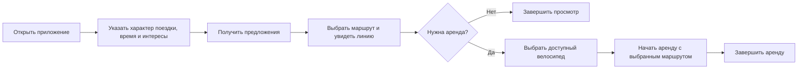
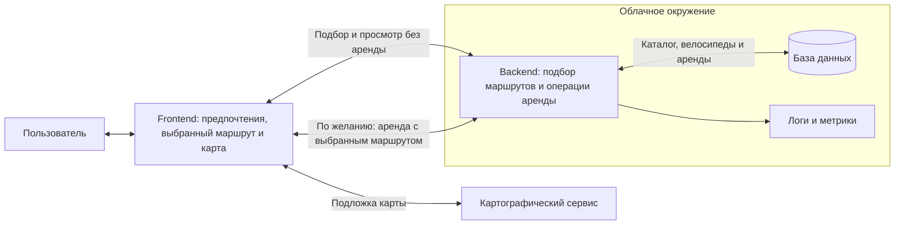
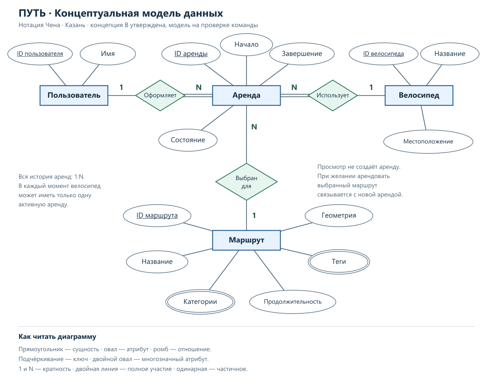

# ПУТЬ — план проекта после первой итерации

**Обновлено 10 ноября 2026 · первый релиз: цель 16 ноября · защита: 27 ноября 2026**

**Первая итерация завершена и рассмотрена на Sprint Review.** Команда одобрила представленные аналитические материалы, требования, диаграммы и Frontend. Концепция B, Казань и роли подтверждены, предварительный стек остаётся рабочей основой. Frontend собирается, но использует mock по умолчанию. Архитектура Backend подготовлена Ириной, её отчёт и реализация пока не доступны для аудита. Kubernetes предоставлен, совместная настройка CD запланирована. Полный интегрированный сценарий ещё не подтверждён.

**Статусы:** «утверждено» — решение команды; «рабочая основа» — принятые материалы с открытыми деталями интеграции; «предложение / открыто» — ещё требует подтверждения. Одобрение на Review не доказывает работоспособность релиза. Точная дата Sprint Review не сообщена.

[Отчёт первой итерации и аудит интеграции](ITERATION_1_REVIEW.md) · [Рабочий план второй итерации до 16 ноября](ITERATION_2.md) · [Исторический план первой итерации](ITERATION_1.md).

Для короткого обзора на 15–20 минут: концепция и MVP → роли и план → диаграммы → открытые вопросы. Приложение содержит ориентиры для дальнейшей работы.

## 1. Идея проекта и утверждённое позиционирование

**Утверждён вариант B — персонализированные велопрогулки с дополнительной возможностью аренды велосипеда.** Основная ценность — помочь пользователю выбрать подходящий маршрут. Предпочтения → рекомендации → маршрут на карте → при желании аренда. Для просмотра и выбора маршрута активная аренда не нужна.

**Город утверждён: Казань.** Причина выбора команды — возможность подготовить более разнообразный каталог. Конкретные маршруты и источники геоданных ещё предстоит проверить. Первоначальная идея проката сохранена в виде обязательной для MVP демонстрационной аренды, ранее заявленной преподавателю.

Велосипеды могут быть предпочтительнее самокатов для части пользователей, в том числе **по воспринимаемой безопасности**. Это гипотеза для исследования, а не установленное преимущество или утверждение, что велосипед объективно безопаснее. Наличие спроса, конкурентов и возможная ценность для МТС также требуют проверки.

### Каталог маршрутов: простая предлагаемая классификация

| Категория / характер поездки | Для какого запроса |
|---|---|
| Туристический | Посмотреть город и достопримечательности |
| Активный | Тренировка или более интенсивная прогулка |
| Спокойный | Лёгкая прогулка в комфортном темпе |

Используем заранее подготовленные маршруты, **без ML и автоматической генерации**. «Характер поездки» заменяет прежний переключатель настроения, а не добавляется четвёртым фильтром: характер + продолжительность + 2–3 тега интересов. Маршрут может подходить нескольким категориям. Карточка каталога: ID, название, краткое описание, категории, оценочная длительность, теги, геометрия и точка старта; для редакторов — источник и отметка проверки. Первоначальный ориентир **5 маршрутов остаётся предварительным**.

**Задача аналитиков:** проверить предложения и спрос в Казани, причины выбора велосипеда вместо самоката, полезность трёх категорий и потенциальную связь с МТС. Анна собирает источники и пользовательские свидетельства; Сергей переводит выводы в требования. Воспринимаемую безопасность и объективные риски не смешивать. «Не нашли аналог» не равно «аналогов нет».

## 2. MVP, пользовательские сценарии и критерии успеха

**Задано:** преподавателю уже обозначены аренда велосипедов и предложение маршрутов по настройкам пользователя. **Обе функции обязательны для MVP; пользоваться арендой необязательно.** Изменение этого обязательства требует отдельного согласования.

**Ближайшая цель — вертикальный срез к 16.11:** один подготовленный маршрут, один вымышленный велосипед, реальные Frontend/Backend, линия на карте, начало и завершение аренды с серверным состоянием, Kubernetes, доступные логи и проверки. Просмотр без аренды сохраняется. Это первый релиз, а не весь итоговый MVP. Реальных платежей, оборудования и интеграций с прокатами нет. Детальные критерии — в [ITERATION_2.md](ITERATION_2.md).

### Предлагаемый объём

| Включить в MVP | Граница упрощения |
|---|---|
| Рекомендации по характеру поездки, времени и интересам; просмотр на карте | Доступны без активной аренды; подготовленный каталог и простое ранжирование |
| По желанию — выбор велосипеда, начало, состояние и завершение аренды | Выбранный маршрут связывается с арендой; без оплаты, замков и реального транспорта |
| Карта велосипедов и выбранного маршрута | Отображение своих маркеров и линий, без GPS-навигации |
| Казань; предварительно 3 демонстрационных велосипеда и 5 маршрутов | Общая точка старта — пока предложение для упрощения связи маршрута и велосипеда |
| Характер: туристический / активный / спокойный; время: до 15 / 30 / 60 минут; 2–3 тега | Конкретные теги и покрытие категорий уточняются по каталогу Казани |
| Сохранение текущей аренды и понятные ошибки | После обновления страницы состояние восстанавливается с сервера |
| Облако, проверки, логи, метрики, аналитические документы | Обязательная часть учебного результата |

**Предложение по доступу:** один демонстрационный пользователь без регистрации. Общая сессия проста, но посетители будут видеть и менять одну аренду. Команда должна принять это ограничение либо оценить отдельные анонимные сессии до разработки. Авторизация и личные кабинеты автоматически в MVP не добавляются.

На защите показываем два пути: подбор и просмотр без аренды; затем переход от выбранного маршрута к демонстрационной аренде и её завершению. Отказ от аренды не мешает просмотру маршрута. Основной поток показан в разделе 5.

### Что будет считаться успехом

> За оставшийся срок мы создадим приложение персонализированных велопрогулок по Казани: пользователь получит подготовленные маршруты по своим настройкам, выберет маршрут и посмотрит его на карте без аренды. При желании он сможет начать и завершить демонстрационную аренду. Успех подтверждаем обоими сценариями, облачным размещением и результатами проверок.

| Уровень | Проверяемый результат |
|---|---|
| Минимальный продуктовый | Предпочтения → рекомендации → выбранный маршрут на карте без аренды; отдельно проверен переход от него к выбору велосипеда, началу и завершению аренды |
| Целевой для курса | Предварительно 5 проверенных маршрутов; оба пути проходят 3 раза подряд; просмотр не создаёт аренду; выбранный маршрут связан с последующей арендой; состояние аренды сохраняется при обновлении и перезапуске; облако, логи, метрики, документы и репетиция готовы |
| Дополнительный | Улучшение объяснений или ещё 1–3 маршрута — только после приёмки обязательного результата |

### Критерии курса

| Критерий | Максимум | Доказательство результата |
|---|---:|---|
| Lean Canvas | 15 | Бизнес-модель с отделёнными фактами и гипотезами |
| ТЗ, User Stories, Use Cases, ПМИ | 15 | Требования, сценарии и программа/методика испытаний с результатами |
| Frontend | 20 | Работающий интерфейс, карта и обработка ошибок |
| Backend | 20 | Реальные операции аренды, хранение и подбор маршрутов |
| Развёртывание в облаке | 10 | Доступный публичный стенд |
| Наблюдаемость | 20 | Логи, метрики запросов и продуктовых событий, пример диагностики |
| **Всего** | **100** | **Для A нужны 85+ и работающий прототип в облаке** |

Основание — [материалы курса, слайды 4 и 7](../references/Intro%2004092026.pdf), доступные в общей рабочей папке вне Git-репозитория. Баллы 15/15/20/20/10/20 и условие A «85+ и работающий прототип в облаке» сверены 10.11. Локальный прототип сам по себе не обеспечивает A. Публичность стенда и необходимость VPN для зрителя уточняет Амир у команды курса. Логи и базовая диагностика нужны к 16.11, полный объём наблюдаемости и документов сохраняется до защиты.

## 3. Распределение ответственности между пятью участниками

**Роли утверждены на первом собрании.** Владелец отвечает за результат; необходимые проверки и решения обсуждаются совместно.

| Участник | Зона ответственности | Основные результаты |
|---|---|---|
| **Ирина** | Backend, данные, правила аренды и подбора | Модель данных, договорённости об обмене, API, серверные тесты и события для наблюдаемости |
| **Анна** | Продуктовая аналитика | Требования к велопрогулкам, рынок Казани и гипотезы, Lean Canvas, категории и содержание маршрутов, пользовательская проверка |
| **Егор** | Frontend и карта | Исследование доступных картографических сервисов и выбор решения; интерфейс, карта, подключение Backend и обработка ошибок |
| **Амир** | DevOps и координация | Условия сервера, CI и развёртывание, сбор метрик, выпуск и контроль блокеров |
| **Сергей** | Системная аналитика и качество | ТЗ, US/UC, диаграммы, ПМИ, проверка данных, приёмка и соответствие критериям |

Анна помогает вести задачи и статусы; Сергей — проверки и протокол решений. Это разгружает Амира. Разработчики обязательно участвуют в архитектуре; аналитики — в проверке данных, интерфейса и интеграции.

**Исходная оценка четырёх недель, включая встречи и резерв, сохранена как ориентир:**

| Участник | Неделя 1 | Неделя 2 | Неделя 3 | Неделя 4 | Всего |
|---|---:|---:|---:|---:|---:|
| Ирина | 4 | 5 | 5 | 4 | 18 |
| Егор | 4 | 5 | 5 | 4 | 18 |
| Амир | 4 | 4 | 4 | 4 | 16 |
| Анна | 4 | 3 | 3 | 4 | 14 |
| Сергей | 4 | 3 | 3 | 4 | 14 |
| **Команда** | **20** | **20** | **20** | **20** | **80 ч** |

Ограничение **3–5 часов в неделю на человека** сохранено. Таблица — первоначальная оценка, не фактические затраты и не утверждённый остаток. В новом плане Н2 предложены Ирина 5 ч, Егор 5 ч, Амир 5 ч, Анна 3,5 ч, Сергей 4,5 ч — **23 ч**, включая согласования и 2 ч резерва. Этот план заменяет прежние 20 ч Н2. Амир сверяет уже затраченное время и остаток до защиты, не прибавляя автоматически новые часы к 80. Работа 16.11 также учитывается в лимите недели 16–22.11.

## 4. Общий план работ и задачи команды

Исходный [план Н1](ITERATION_1.md) сохранён как исторический. Результаты и расхождения собраны в [отчёте Review](ITERATION_1_REVIEW.md), задачи с оценками и критериями — в [плане Н2](ITERATION_2.md). Следующий roadmap — предложение после Review, учитывающее цель выпуска 16.11.

| Период | Общая работа команды | Результат для перехода дальше |
|---|---|---|
| **1 · 29.10–04.11, исторический план** | Аналитика, требования, схемы и границы компонентов | Представленные результаты одобрены на Review. Есть Frontend сверх обязательного аналитического результата. Открыты материалы Backend, детали API/карты/выпуска и проверенная геометрия |
| **2 · новый прогноз 10–16.11** | Сверка API и существующих конфигураций, один маршрут, локальный цикл, сборка, Kubernetes и приёмка | Предложения: 11.11 — интерфейсы, 13.11 — полный локальный цикл, 14.11 — RC, 15.11 — стенд, 16.11 — исправления/приёмка. Цель — оба пути с реальным Backend, серверным состоянием и логами |
| **3 · 17–22.11** | Устойчивость, метрики запросов/продукта, диагностика, проверка гипотез и каталог в оставшемся бюджете | Не добавлять функции после **18.11**. Расширение данных только после приёмки среза. Полный состав наблюдаемости сверить с курсом, подготовить доказательства и ПМИ |
| **4 · 23–27.11** | Регрессия, восстановление, завершение документов и репетиция | Нет блокирующих дефектов. 26.11 — финальная доступность, 27.11 — защита. Презентация и поддержка показа входят в недельные часы |

**Первоначальный ресурс — 80 ч** с резервом 8 ч. Фактическое расходование после Н1 не представлено, поэтому прежние 6,75 ч оставшегося резерва не считаем подтверждёнными. План Н2 содержит 18,5 ч предметной работы, 2,5 ч согласований и 2 ч резерва. При подтверждении доступности только 3 ч у разработчика объём необходимо пересчитать, скрытых сверхурочных нет. Период 05–09.11 не объявляется ни выполненной итерацией, ни свободным дополнительным ресурсом.

Главный риск второго этапа — неизвестный остаток Backend и готовность доставки. Берём существующий интерфейс и один маршрут, сразу соединяем компоненты. Если полного локального сценария нет к предложенной точке 13.11, команда пересматривает прогноз. Сокращаем оформление и расширение каталога, сохраняя аренду **и** рекомендации. Mock в браузере не является заменой Backend при приёмке.

Организация: одно короткое недельное обсуждение, статусы после рабочих блоков, одна доска задач, небольшие изменения с проверкой вторым участником. На человека заложено 30 минут взаимодействия, технические согласования и проверки входят в предметные задачи. Разработчики отвечают за интеграцию собственных компонентов, аналитики — за данные/приёмку, Амир — за сборку, доставку и координацию блокеров.

## 5. Основные архитектурные диаграммы

User Flow отражает **утверждённую концепцию B**. [Диаграммы Сергея](1%20Спринт%20-%20Диаграммы.pdf) приняты на Sprint Review как рабочая основа. Схемы ниже сохранены, детали API и реализации БД подтверждают Ирина и Егор. Поток A в PDF остаётся справочным, повторный выбор концепции не требуется.

### User Flow: сначала прогулка, аренда по желанию

Общие альтернативы: велосипед занят — обновить выбор; ничего не подошло — объяснить причину и предложить изменить фильтры; API/карта недоступны — сообщение и повтор. Время не превышается скрытно. Активную аренду можно завершить, даже если рекомендации или карта временно не работают. После обновления страницы состояние аренды восстанавливается с сервера.

### Component Diagram: подбор не зависит от активной аренды

Frontend хранит текущий выбор маршрута на экране; Backend возвращает рекомендации и геометрию без проверки активной аренды. При начале аренды Frontend передаёт выбранный маршрут, Backend проверяет его и доступность велосипеда, а БД сохраняет связь. Сам просмотр не создаёт аренду и не резервирует велосипед. Карта отображает подготовленные линии, не генерирует их. Это целевая схема, в текущем checkout серверная часть не представлена. Статический Frontend можно отдавать тем же Backend, окончательную упаковку сверяют с существующими решениями Ирины и Амира.

**Размещение уточнено:** предоставлен Kubernetes `student-cluster`, namespace `team-2`. Kubeconfig найден, доступ ранее проверен Амиром. Манифесты приложения и общего CD в доступной папке не найдены, их местонахождение уточняется. Кластер и его общие сервисы повторно не создаём. Предложение коллеги о Flux известно, действующий инструмент CD пока не установлен по материалам.

Новых сервисов и второй БД не требуется. Аренда и подбор остаются операциями одного Backend; состояние аренды хранится на сервере, логика ранжирования не дублируется в интерфейсе.

### Концептуальная ER-диаграмма: строго Chen's Notation

[Принятая рабочая ER-схема Сергея — страница 4 PDF](1%20Спринт%20-%20Диаграммы.pdf). PNG выше — существующая иллюстрация плана. Обе сохранены без перерисовки. Старые подписи статуса/«настроения» читаются с учётом Review, смысл кратностей и участия раскрыт в таблице ниже.

**Легенда:** прямоугольник — сущность; овал — атрибут; ромб — отношение. Ключ подчёркнут; двойной овал — многозначный атрибут. Метки 1:N задают кратность; двойная линия обозначает полное участие, одинарная — частичное. Это концептуальная модель, без типов SQL и внешних ключей.

| Отношение | Кратность и участие простыми словами |
|---|---|
| Пользователь **оформляет** аренду | У пользователя 0…N аренд за всё время; каждая аренда относится ровно к одному пользователю. Участие аренды полное, пользователя — частичное |
| Аренда **использует** велосипед | Каждая аренда использует ровно один велосипед; велосипед участвует в 0…N арендах за всё время. Участие аренды полное, велосипеда — частичное |
| Маршрут **выбран для** аренды | У аренды 0…1 выбранный маршрут; маршрут выбирается для 0…N аренд. Участие обеих сущностей частичное |

Связи ER уже допускают просмотр каталога без аренды, поэтому их кратности и участие сохранены. Просмотр не создаёт отдельную сущность «рекомендация»; при переходе к аренде сохраняется выбранный маршрут. Возможность 0…1 маршрута не требует нового сценария аренды без маршрута. Запрет двух активных аренд одного велосипеда — отдельное правило времени, а не историческая связь 1:1. Атрибут «Настроения» переименован в «Категории» под классификацию каталога; отдельная таблица категорий на концептуальной схеме не нужна.

«Пользователь» обозначает участника предметной области: в демонстрации он может быть один, без регистрации. Детали хранения этого участника решаются позднее. Нотация сверена с [документацией Chen ER](https://plantuml.com/er-diagram).

## 6. Технологический стек — рабочая основа

**Предварительный стек принят командой как рабочая основа.** Повторное сравнение не требуется. React/Vite подтверждены кодом, детали Backend ещё подтверждает Ирина. Окончательный картографический API выбирает Егор, текущий импорт не является финальным командным выбором.

| Часть | Рабочая основа / кандидат | Краткое основание / условие |
|---|---|---|
| Интерфейс | React + Vite | Один небольшой экран и удобная сборка. Node.js нужен для инструментов; это не альтернатива React |
| Backend | Python + FastAPI | Удобны валидация и описание обмена; работаем от этой основы |
| Данные | SQLite — ранее согласованный простой вариант, сверить с Ириной | Для SQLite — постоянное хранилище/PVC, одна пишущая копия Backend и обновление без параллельных писателей. Подходящее хранилище и способ копии ещё подтвердить, БД не привязывается к жизни Pod |
| Карта | **Выбор открыт: ответственность Егора** | В коде активен Яндекс JS API 2.1. Есть неактивные MapLibre/OpenFreeMap и Яндекс 3.0. Проверить ключ/домен, линию, условия и доступность на стенде |
| Размещение | Существующий Kubernetes, namespace `team-2` | Уточнить готовые манифесты, image registry, вход/домен, VPN для браузера и ресурсы. Vite-прокси работает только в разработке, production `/api` нужен отдельно |
| CI/CD | GitHub, конкретный механизм согласуется | В checkout нет workflow. Общий CD планируется с коллегой. Амир отвечает за CI/образ и подключение своего приложения, коллега — за общий CD |
| Проверки и наблюдаемость | Сборка, проверки реального сценария, stdout/stderr, затем метрики | К 16.11 — работоспособность и доступные логи. До защиты — метрики запросов/продукта и диагностика, предпочтительно средствами курса |

`VITE_*` встраиваются при сборке, поэтому выключение mock и настройки API/карты передаются до создания релизного образа. Серверные секреты в клиентскую сборку не попадают. Неизвестные параметры среды остаются зависимостями с владельцами в [Н2](ITERATION_2.md).

## 7. Риски и вопросы для командного обсуждения

| Риск | Как действуем | Владелец |
|---|---|---|
| Польза утверждённой концепции ещё не проверена | Исследовать подбор прогулок и категории в Казани; не выдавать выбор концепции за доказанный спрос/безопасность | Анна |
| MVP разрастается или не хватает часов | Сначала убрать оформление и расширения; уменьшение каталога согласовать. Аренду и рекомендации сохранить | Амир, команда |
| Backend и интерфейс не соединены к локальному прогону | До предложенного 11.11 получить существующие решения Ирины и сверить API, до 13.11 пройти полный цикл | Ирина, Егор, Сергей |
| Карта или геометрия не готовы | Один подготовленный маршрут, проверка данных аналитиками и карты Егором до полного прогона | Егор, Анна, Сергей |
| Среда/CD задерживают выпуск | Найти существующие конфигурации, подтвердить registry/PVC/вход и участие коллеги. Если CD задерживается — согласовать ручную доставку той же RC, не создавать новую платформу | Амир |
| Компоненты не совпадают / состояние аренды ломается | Договориться об обмене до реализации, рано соединить UI/API, проверить повтор действий и обновление страницы | Ирина, Егор |
| Документы и наблюдаемость отложены | У каждого результата есть владелец; логи с первого запуска, метрики до окончания Н3 | Сергей, Ирина, Амир |
| Общая демосессия мешает показу | Явно принять её ограничение либо оценить независимые сессии до начала реализации | Команда |

Если доступны только 60 ч, нельзя просто пропорционально сжать этот план. Нужна новая оценка работ разработчиков и согласованное сокращение. Рабочее облако и критерии курса не заменяются локальным показом.

### Что ещё требует решения или уточнения

1. Доступ к существующему Backend, команда запуска, остаточная оценка, контракт и режим пользователя — **Ирина с Егором**, предложение контроля 11.11.
2. Карта для релиза, ключ/домен/условия — **Егор**, источник геоданных — **Анна**. Геометрия и проверка — **Анна с Сергеем**, до локального сценария.
3. Repo/path существующих конфигураций, инструмент общего CD, registry, обновление image ref, вход/TLS, VPN и storage/квоты — **Амир с коллегой и командой курса**. Первый ответ предложен на 11.11, срок готовности внешней стороны не известен.
4. Состав итоговой наблюдаемости, трейсы/панель и доступ зрителей — **Амир и Сергей**. Базовые логи к первому релизу, полные доказательства до защиты.
5. Фактические часы Н1 и 05–09.11, доступность на Н2 и оставшийся бюджет — **Амир и команда**, до принятия оценок Н2. Роли сохраняются, Backend не передаётся другим участникам.

**Фиксация:** Сергей ведёт статусы решений и результаты ПМИ, Амир — зависимости и прогноз релиза. 27.11 используется как дата защиты из текущего запроса и расписания курса. Несогласованная дата на слайде 7 не меняет этот ориентир. Доказательства критериев курса собираются по владельцам из раздела 3.

---

## Приложение. Короткие ориентиры для дальнейшего проектирования

Краткие ориентиры для уточнения утверждённой концепции; не подробная техническая спецификация.

- **Обмен:** каталог, рекомендации и геометрия доступны без аренды; выбранный маршрут передаётся при её начале. Отдельно — велосипеды, текущее состояние и завершение аренды. Endpoint-имена и JSON согласуются отдельно.
- **Данные:** один порядок координат «долгота, широта»; геометрии и теги проверены; состояние аренды хранится на сервере. Повтор команды не должен создавать дубль; велосипед не выдаётся двум активным арендам.
- **Подбор:** сначала маршруты в пределах выбранного времени, затем ранжирование по категории и тегам. Нет совпадений — понятная причина и предложение изменить выбор, без скрытого превышения времени.
- **Минимальные испытания:** просмотр без аренды и без изменения её состояния; переход к аренде с тем же маршрутом; неверный ввод; пустая выдача; повтор старта/завершения; конфликт; refresh; сбой карты/API; мобильный экран; сохранность после пересоздания контейнера.
- **Наблюдаемость:** число/ошибки/время запросов, начало и завершение аренды, обращения к рекомендациям; связь ошибки с логом. Request ID не выдаётся за полноценный трейсинг.
- **Хранение и выпуск:** постоянное хранилище БД, проверяемая копия и восстановление, одна рабочая версия, ранний публичный запуск. Установка CI и инфраструктуры — этап реализации со второй недели.

Справочные источники: [FastAPI](https://fastapi.tiangolo.com/features/), [Vite](https://vite.dev/guide/), [область применения SQLite](https://www.sqlite.org/whentouse.html), [условия Яндекс Карт](https://yandex.ru/legal/maps_api/ru/), [ограничения ключа](https://yandex.ru/maps-api/docs/js-api/limit.html), [политика тайлов OSMF](https://operations.osmfoundation.org/policies/tiles/), [Prometheus](https://prometheus.io/docs/prometheus/latest/getting_started/). Применимость условий к выбранному проекту проверяется отдельно.

### Что изменилось 10 ноября после Sprint Review

- Добавлены итоги Review и ссылки на отдельный аудит и план Н2. Исторический `ITERATION_1.md` сохранён.
- Выделен первый релиз 16.11 с одним маршрутом и велосипедом, обновлены roadmap, контроль интеграции и условная оценка времени.
- Уточнены Kubernetes и незавершённое согласование CD, фактический mock-режим и активный адаптер Яндекс 2.1.
- Сохранены продуктовая концепция, роли и схемы. Исправлены ссылки на существующие материалы, открытые зависимости отделены от принятых решений.

