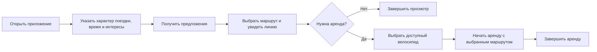
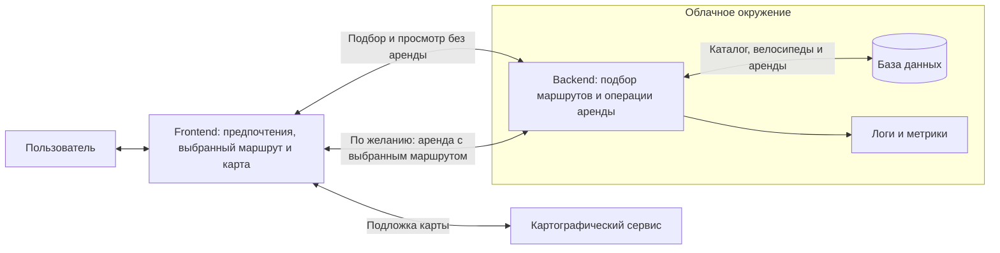

# ПУТЬ — план проекта по итогам первого собрания

**Обновлено 30 октября 2026 · ориентир защиты: 27 ноября 2026**

**Первое собрание состоялось.** Утверждены концепция B, Казань и роли; предварительный стек принят как рабочая основа. Документ фиксирует эти решения и оставшиеся задачи подготовки к разработке.

**Статусы:** «утверждено» — подтверждено командой по итогам встречи; «рабочая основа» — предварительно принято с проверкой применимости; «предложение / открыто» — ещё требует решения. Принятые решения не означают, что задачи выполнены. 30 октября — дата обновления документа; точная дата собрания не сообщена.

Для короткого обзора на 15–20 минут: концепция и MVP → роли и план → диаграммы → открытые вопросы. Приложение содержит ориентиры для дальнейшей работы.

## 1. Идея проекта и утверждённое позиционирование

**Утверждён вариант B — персонализированные велопрогулки с дополнительной возможностью аренды велосипеда.** Основная ценность — помочь пользователю выбрать подходящий маршрут. Предпочтения → рекомендации → маршрут на карте → при желании аренда. Для просмотра и выбора маршрута активная аренда не нужна.

**Город утверждён: Казань.** Причина выбора команды — возможность подготовить более разнообразный каталог. Конкретные маршруты и источники геоданных ещё предстоит проверить. Первоначальная идея проката сохранена в виде обязательной для MVP демонстрационной аренды, ранее заявленной преподавателю.

Велосипеды могут быть предпочтительнее самокатов для части пользователей, в том числе **по воспринимаемой безопасности**. Это гипотеза для исследования, а не установленное преимущество или утверждение, что велосипед объективно безопаснее. Наличие спроса, конкурентов и возможная ценность для МТС также требуют проверки.

### Каталог маршрутов: простая предлагаемая классификация

| Категория / характер поездки | Для какого запроса |
|---|---|
| Туристический | Посмотреть город и достопримечательности |
| Активный | Тренировка или более интенсивная прогулка |
| Спокойный | Лёгкая прогулка в комфортном темпе |

Используем заранее подготовленные маршруты, **без ML и автоматической генерации**. «Характер поездки» заменяет прежний переключатель настроения, а не добавляется четвёртым фильтром: характер + продолжительность + 2–3 тега интересов. Маршрут может подходить нескольким категориям. Карточка каталога: ID, название, краткое описание, категории, оценочная длительность, теги, геометрия и точка старта; для редакторов — источник и отметка проверки. Первоначальный ориентир **5 маршрутов остаётся предварительным**.

**Задача аналитиков:** проверить предложения и спрос в Казани, причины выбора велосипеда вместо самоката, полезность трёх категорий и потенциальную связь с МТС. Анна собирает источники и пользовательские свидетельства; Сергей переводит выводы в требования. Воспринимаемую безопасность и объективные риски не смешивать. «Не нашли аналог» не равно «аналогов нет».

## 2. MVP, пользовательские сценарии и критерии успеха

**Задано:** преподавателю уже обозначены аренда велосипедов и предложение маршрутов по настройкам пользователя. **Обе функции обязательны для MVP; пользоваться арендой необязательно.** Изменение этого обязательства требует отдельного согласования.

### Предлагаемый объём

| Включить в MVP | Граница упрощения |
|---|---|
| Рекомендации по характеру поездки, времени и интересам; просмотр на карте | Доступны без активной аренды; подготовленный каталог и простое ранжирование |
| По желанию — выбор велосипеда, начало, состояние и завершение аренды | Выбранный маршрут связывается с арендой; без оплаты, замков и реального транспорта |
| Карта велосипедов и выбранного маршрута | Отображение своих маркеров и линий, без GPS-навигации |
| Казань; предварительно 3 демонстрационных велосипеда и 5 маршрутов | Общая точка старта — пока предложение для упрощения связи маршрута и велосипеда |
| Характер: туристический / активный / спокойный; время: до 15 / 30 / 60 минут; 2–3 тега | Конкретные теги и покрытие категорий уточняются по каталогу Казани |
| Сохранение текущей аренды и понятные ошибки | После обновления страницы состояние восстанавливается с сервера |
| Облако, проверки, логи, метрики, аналитические документы | Обязательная часть учебного результата |

**Предложение по доступу:** один демонстрационный пользователь без регистрации. Общая сессия проста, но посетители будут видеть и менять одну аренду. Команда должна принять это ограничение либо оценить отдельные анонимные сессии до разработки. Авторизация и личные кабинеты автоматически в MVP не добавляются.

На защите показываем два пути: подбор и просмотр без аренды; затем переход от выбранного маршрута к демонстрационной аренде и её завершению. Отказ от аренды не мешает просмотру маршрута. Основной поток показан в разделе 5.

### Что будет считаться успехом

> За оставшийся срок мы создадим приложение персонализированных велопрогулок по Казани: пользователь получит подготовленные маршруты по своим настройкам, выберет маршрут и посмотрит его на карте без аренды. При желании он сможет начать и завершить демонстрационную аренду. Успех подтверждаем обоими сценариями, облачным размещением и результатами проверок.

| Уровень | Проверяемый результат |
|---|---|
| Минимальный продуктовый | Предпочтения → рекомендации → выбранный маршрут на карте без аренды; отдельно проверен переход от него к выбору велосипеда, началу и завершению аренды |
| Целевой для курса | Предварительно 5 проверенных маршрутов; оба пути проходят 3 раза подряд; просмотр не создаёт аренду; выбранный маршрут связан с последующей арендой; состояние аренды сохраняется при обновлении и перезапуске; облако, логи, метрики, документы и репетиция готовы |
| Дополнительный | Улучшение объяснений или ещё 1–3 маршрута — только после приёмки обязательного результата |

### Критерии курса

| Критерий | Максимум | Доказательство результата |
|---|---:|---|
| Lean Canvas | 15 | Бизнес-модель с отделёнными фактами и гипотезами |
| ТЗ, User Stories, Use Cases, ПМИ | 15 | Требования, сценарии и программа/методика испытаний с результатами |
| Frontend | 20 | Работающий интерфейс, карта и обработка ошибок |
| Backend | 20 | Реальные операции аренды, хранение и подбор маршрутов |
| Развёртывание в облаке | 10 | Доступный публичный стенд |
| Наблюдаемость | 20 | Логи, метрики запросов и продуктовых событий, пример диагностики |
| **Всего** | **100** | **Для A нужны 85+ и работающий прототип в облаке** |

Основание — [материалы курса, слайды 4 и 7](references/Intro%2004092026.pdf). Локальный функциональный прототип сам по себе не обеспечивает A; баллы определяет преподаватель.

## 3. Распределение ответственности между пятью участниками

**Роли утверждены на первом собрании.** Владелец отвечает за результат; необходимые проверки и решения обсуждаются совместно.

| Участник | Зона ответственности | Основные результаты |
|---|---|---|
| **Ирина** | Backend, данные, правила аренды и подбора | Модель данных, договорённости об обмене, API, серверные тесты и события для наблюдаемости |
| **Анна** | Продуктовая аналитика | Требования к велопрогулкам, рынок Казани и гипотезы, Lean Canvas, категории и содержание маршрутов, пользовательская проверка |
| **Егор** | Frontend и карта | Исследование доступных картографических сервисов и выбор решения; интерфейс, карта, подключение Backend и обработка ошибок |
| **Амир** | DevOps и координация | Условия сервера, CI и развёртывание, сбор метрик, выпуск и контроль блокеров |
| **Сергей** | Системная аналитика и качество | ТЗ, US/UC, диаграммы, ПМИ, проверка данных, приёмка и соответствие критериям |

Анна помогает вести задачи и статусы; Сергей — проверки и протокол решений. Это разгружает Амира. Разработчики обязательно участвуют в архитектуре; аналитики — в проверке данных, интерфейса и интеграции.

**Предлагаемая загрузка, включая встречи и резерв:**

| Участник | Неделя 1 | Неделя 2 | Неделя 3 | Неделя 4 | Всего |
|---|---:|---:|---:|---:|---:|
| Ирина | 4 | 5 | 5 | 4 | 18 |
| Егор | 4 | 5 | 5 | 4 | 18 |
| Амир | 4 | 4 | 4 | 4 | 16 |
| Анна | 4 | 3 | 3 | 4 | 14 |
| Сергей | 4 | 3 | 3 | 4 | 14 |
| **Команда** | **20** | **20** | **20** | **20** | **80 ч** |

Ограничение **3–5 часов в неделю на человека** сохранено. Реальная доступность ещё должна быть подтверждена; работа идёт отдельными блоками, а не ежедневно.

## 4. Общий план работ и задачи команды

Детальный план первой недели: **[ITERATION_1.md](ITERATION_1.md)**. Backlog реализации уточняется под утверждённую концепцию B; сроки и плановая загрузка сохранены. Завершённое собрание не означает завершения первой итерации.

| Период | Общая работа команды | Результат для перехода дальше |
|---|---|---|
| **1 · 29.10–04.11** | На основе решений встречи уточнить требования, каталог Казани, сценарии без аренды и с ней, компоненты и обмен; Егор исследует и выбирает карту, Амир уточняет ресурсы | Концепция, город и роли уже утверждены; остальные результаты — согласованные требования, схемы и проверки карты/сервера — ещё предстоят. **Работающий код не является целью этой недели** |
| **2 · 05–11.11** | Разработчики соединяют подбор, карту и необязательную аренду; аналитики готовят первую геометрию и проверяют оба пути; Амир подключает сборку и раннее облако | В начале недели UI получает реальные данные Backend; к концу — подбор и линия без аренды, затем аренда с выбранным маршрутом и завершение. Логи с первого запуска. Цель — эти же пути в облаке |
| **3 · 12–18.11** | Довести каталог и интерфейс, проверить ошибки и перезапуск, собрать метрики, провести пользовательские проверки и исправления | Основной MVP доступен в облаке; ориентир — 5 маршрутов, логи и собираемые метрики. После блока 13–14 ноября уточнена диагностика. **18 ноября — прекращение добавления функций** |
| **4 · 19–25.11** | Повторные проверки, исправления, завершение документов, проверка восстановления и репетиция | Нет блокирующих дефектов; готов релиз, доказательства критериев и показ на 5–7 минут. 26 ноября — проверка доступности, 27 ноября — защита, без дополнительных часов сверх бюджета |

**Ресурс 80 ч:** 62 ч предметной работы, 10 ч взаимодействия, 8 ч резерва. Внутри 62 ч ориентировочно 18 ч защищаем для интеграции, проверки данных, испытаний и исправлений; это не дополнительные часы. Из резерва 1,25 ч предусмотрено в первой итерации, 6,75 ч остаётся на следующие недели.

Перенос разработки с первой недели повышает риск второй: берём один маршрут и простейший интерфейс, сразу соединяем компоненты. При отставании сначала уменьшаем оформление и число подготовленных маршрутов по согласованию, сохраняя аренду **и** рекомендации. Нельзя заменить Backend имитацией в браузере или отложить первую интеграцию до конца проекта.

Организация: одно короткое недельное обсуждение, статусы после рабочих блоков, одна доска задач, небольшие изменения с проверкой вторым участником. На человека заложено 30 минут взаимодействия в неделю; состоявшееся первое собрание входит в этот лимит, повторно его не планируем. Технические проверки входят в задачи участников.

## 5. Основные архитектурные диаграммы

User Flow отражает **утверждённую концепцию B**. Компоненты и модель данных уточняются в первой итерации; их отдельное утверждение командой пока не зафиксировано.

### User Flow: сначала прогулка, аренда по желанию

Общие альтернативы: велосипед занят — обновить выбор; ничего не подошло — объяснить причину и предложить изменить фильтры; API/карта недоступны — сообщение и повтор. Время не превышается скрытно. Активную аренду можно завершить, даже если рекомендации или карта временно не работают. После обновления страницы состояние аренды восстанавливается с сервера.

### Component Diagram: подбор не зависит от активной аренды

Frontend хранит текущий выбор маршрута на экране; Backend возвращает рекомендации и геометрию без проверки активной аренды. При начале аренды Frontend передаёт выбранный маршрут, Backend проверяет его и доступность велосипеда, а БД сохраняет связь. Сам просмотр не создаёт аренду и не резервирует велосипед. Карта отображает подготовленные линии, не генерирует их. Статический Frontend можно отдавать тем же Backend.

Новых сервисов и второй БД не требуется. Аренда и подбор остаются операциями одного Backend; состояние аренды хранится на сервере, логика ранжирования не дублируется в интерфейсе.

### Концептуальная ER-диаграмма: строго Chen's Notation

[Открыть векторную диаграмму SVG для увеличения или правки](diagrams/PUT_ER_Chen.svg).

**Легенда:** прямоугольник — сущность; овал — атрибут; ромб — отношение. Ключ подчёркнут; двойной овал — многозначный атрибут. Метки 1:N задают кратность; двойная линия обозначает полное участие, одинарная — частичное. Это концептуальная модель, без типов SQL и внешних ключей.

| Отношение | Кратность и участие простыми словами |
|---|---|
| Пользователь **оформляет** аренду | У пользователя 0…N аренд за всё время; каждая аренда относится ровно к одному пользователю. Участие аренды полное, пользователя — частичное |
| Аренда **использует** велосипед | Каждая аренда использует ровно один велосипед; велосипед участвует в 0…N арендах за всё время. Участие аренды полное, велосипеда — частичное |
| Маршрут **выбран для** аренды | У аренды 0…1 выбранный маршрут; маршрут выбирается для 0…N аренд. Участие обеих сущностей частичное |

Связи ER уже допускают просмотр каталога без аренды, поэтому их кратности и участие сохранены. Просмотр не создаёт отдельную сущность «рекомендация»; при переходе к аренде сохраняется выбранный маршрут. Возможность 0…1 маршрута не требует нового сценария аренды без маршрута. Запрет двух активных аренд одного велосипеда — отдельное правило времени, а не историческая связь 1:1. Атрибут «Настроения» переименован в «Категории» под классификацию каталога; отдельная таблица категорий на концептуальной схеме не нужна.

«Пользователь» обозначает участника предметной области: в демонстрации он может быть один, без регистрации. Детали хранения этого участника решаются позднее. Нотация сверена с [документацией Chen ER](https://plantuml.com/er-diagram).

## 6. Технологический стек — рабочая основа

**Предварительный стек принят командой как рабочая основа.** Повторное сравнение не требуется; применимость к серверу ещё проверяется. Картографический API пока не выбран — исследование и выбор выполняет Егор.

| Часть | Рабочая основа / кандидат | Краткое основание / условие |
|---|---|---|
| Интерфейс | React + Vite | Один небольшой экран и удобная сборка. Node.js нужен для инструментов; это не альтернатива React |
| Backend | Python + FastAPI | Удобны валидация и описание обмена; работаем от этой основы |
| Данные | SQLite | Достаточно для малого стенда с одной копией приложения и постоянным диском. PostgreSQL — если среда или параллельная работа требуют его с начала |
| Карта | **Выбор открыт: ответственность Егора** | Яндекс JavaScript API 3.0 — кандидат, не утверждённое решение; альтернатива — Leaflet с разрешённым поставщиком тайлов. Проверить условия, ключ, линии, доступность и React |
| Размещение | Университетское облако; Docker/Compose при поддержке среды | Один Backend со статическим Frontend. Отдельный Nginx нужен только при отсутствии готового входного proxy/TLS |
| Проверки и наблюдаемость | CI выбранного Git-хостинга, структурированные логи, метрики и простой сборщик | Рассмотреть университетский мониторинг или Prometheus; Grafana не обязательна |

На первой неделе проверяем пригодность и ограничения; технический запуск проверяет эти предположения в начале второй. «Бесплатная карта» и «диск контейнера сохраняется» не считаются подтверждёнными только по названию технологии.

## 7. Риски и вопросы для командного обсуждения

| Риск | Как действуем | Владелец |
|---|---|---|
| Польза утверждённой концепции ещё не проверена | Исследовать подбор прогулок и категории в Казани; не выдавать выбор концепции за доказанный спрос/безопасность | Анна |
| MVP разрастается или не хватает часов | Сначала убрать оформление и расширения; уменьшение каталога согласовать. Аренду и рекомендации сохранить | Амир, команда |
| Первая неделя остаётся бесконечным проектированием | К 04.11 утвердить достаточный набор решений и перейти к одному вертикальному сценарию | Сергей |
| Карта, источник геоданных или сервер не подходят | В Н1 выяснить условия; в начале Н2 проверить запуск. Если доступа нет к 09.11, выбрать согласованный резерв размещения | Егор, Анна, Амир |
| Компоненты не совпадают / состояние аренды ломается | Договориться об обмене до реализации, рано соединить UI/API, проверить повтор действий и обновление страницы | Ирина, Егор |
| Документы и наблюдаемость отложены | У каждого результата есть владелец; логи с первого запуска, метрики до окончания Н3 | Сергей, Ирина, Амир |
| Общая демосессия мешает показу | Явно принять её ограничение либо оценить независимые сессии до начала реализации | Команда |

Если доступны только 60 ч, нельзя просто пропорционально сжать этот план. Нужна новая оценка работ разработчиков и согласованное сокращение. Рабочее облако и критерии курса не заменяются локальным показом.

### Что ещё требует решения или уточнения

1. Картографический сервис, условия использования и источник геоданных — **Егор**, при помощи Анны; ориентир выбора до 04.11, практическая проверка в начале Н2.
2. Конкретные маршруты Казани, теги, число записей и проверяющий; подходит ли общая точка старта — **Анна и Сергей**, первичные требования до 04.11.
3. Общий демонстрационный пользователь или независимые анонимные сессии — **команда**, до реализации аренды.
4. Сервер, домен, постоянное хранилище, сборщик метрик и требования к трейсам/панели — **Амир и Сергей**; вопросы в Н1, контроль доступа до 09.11.
5. Фактические часы, подмена владельцев и завершение согласования схем/критериев — **Амир и команда**, до 04.11. Утверждённые роли не означают автоматического подтверждения всех оценок.

**Фиксация:** Сергей ведёт реестр решений в первой итерации; незакрытые вопросы получают владельца и срок. Анна уточняет согласование темы и даты у преподавателя. В PDF есть противоречащая расписанию дата на слайде 7, поэтому рабочая дата 27.11 требует подтверждения.

---

## Приложение. Короткие ориентиры для дальнейшего проектирования

Краткие ориентиры для уточнения утверждённой концепции; не подробная техническая спецификация.

- **Обмен:** каталог, рекомендации и геометрия доступны без аренды; выбранный маршрут передаётся при её начале. Отдельно — велосипеды, текущее состояние и завершение аренды. Endpoint-имена и JSON согласуются отдельно.
- **Данные:** один порядок координат «долгота, широта»; геометрии и теги проверены; состояние аренды хранится на сервере. Повтор команды не должен создавать дубль; велосипед не выдаётся двум активным арендам.
- **Подбор:** сначала маршруты в пределах выбранного времени, затем ранжирование по категории и тегам. Нет совпадений — понятная причина и предложение изменить выбор, без скрытого превышения времени.
- **Минимальные испытания:** просмотр без аренды и без изменения её состояния; переход к аренде с тем же маршрутом; неверный ввод; пустая выдача; повтор старта/завершения; конфликт; refresh; сбой карты/API; мобильный экран; сохранность после пересоздания контейнера.
- **Наблюдаемость:** число/ошибки/время запросов, начало и завершение аренды, обращения к рекомендациям; связь ошибки с логом. Request ID не выдаётся за полноценный трейсинг.
- **Хранение и выпуск:** постоянное хранилище БД, проверяемая копия и восстановление, одна рабочая версия, ранний публичный запуск. Установка CI и инфраструктуры — этап реализации со второй недели.

Справочные источники: [FastAPI](https://fastapi.tiangolo.com/features/), [Vite](https://vite.dev/guide/), [область применения SQLite](https://www.sqlite.org/whentouse.html), [условия Яндекс Карт](https://yandex.ru/legal/maps_api/ru/), [ограничения ключа](https://yandex.ru/maps-api/docs/js-api/limit.html), [политика тайлов OSMF](https://operations.osmfoundation.org/policies/tiles/), [Prometheus](https://prometheus.io/docs/prometheus/latest/getting_started/). Применимость условий к выбранному проекту проверяется отдельно.

### Что изменилось относительно предыдущей версии

- Зафиксированы концепция B, Казань, утверждённые роли и предварительно принятый стек.
- Уточнены каталог, критерии успеха и независимость просмотра от необязательной аренды; обновлены User Flow и Component Diagram.
- Связи Chen ER сохранены; уточнены подписи и категории. Выбор карты закреплён за Егором и остаётся открытым.
- Задачи Н1 актуализированы без объявления всей итерации завершённой. Сроки и загрузка 80 ч сохранены; локальные ссылки сделаны относительными.

