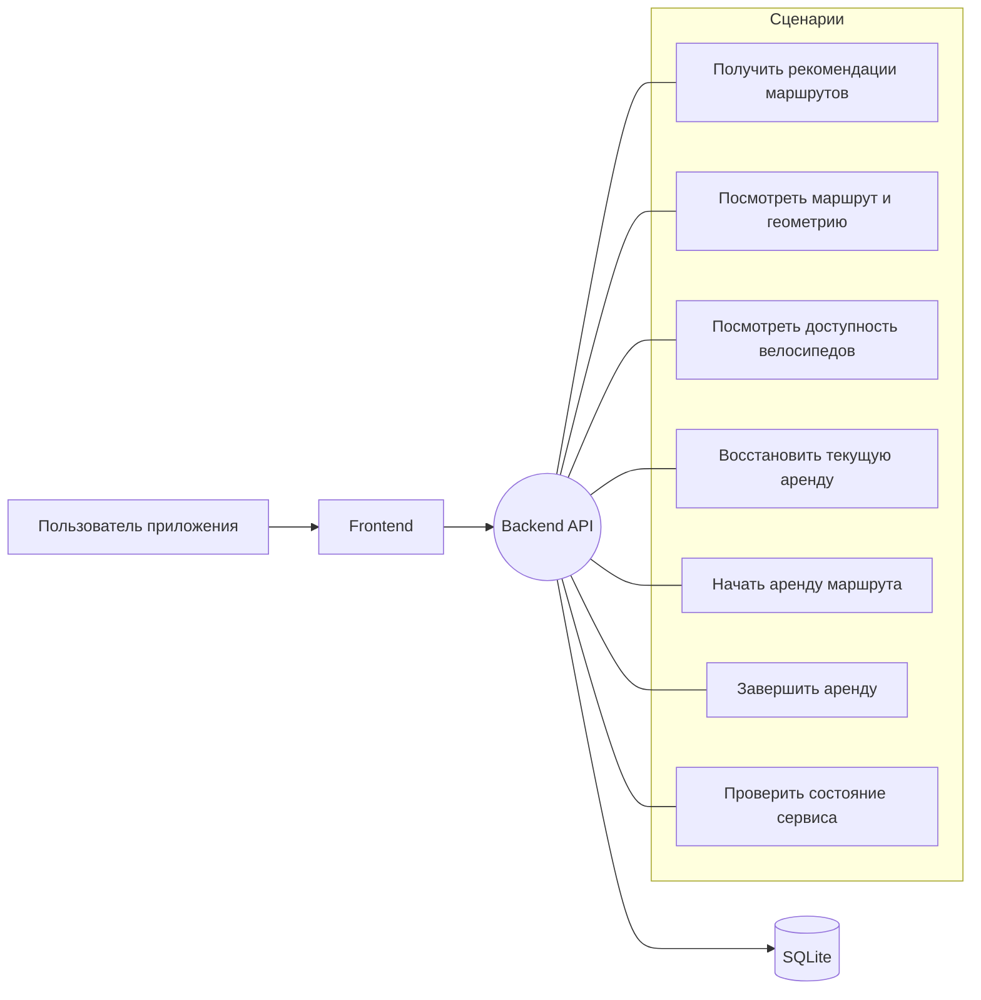
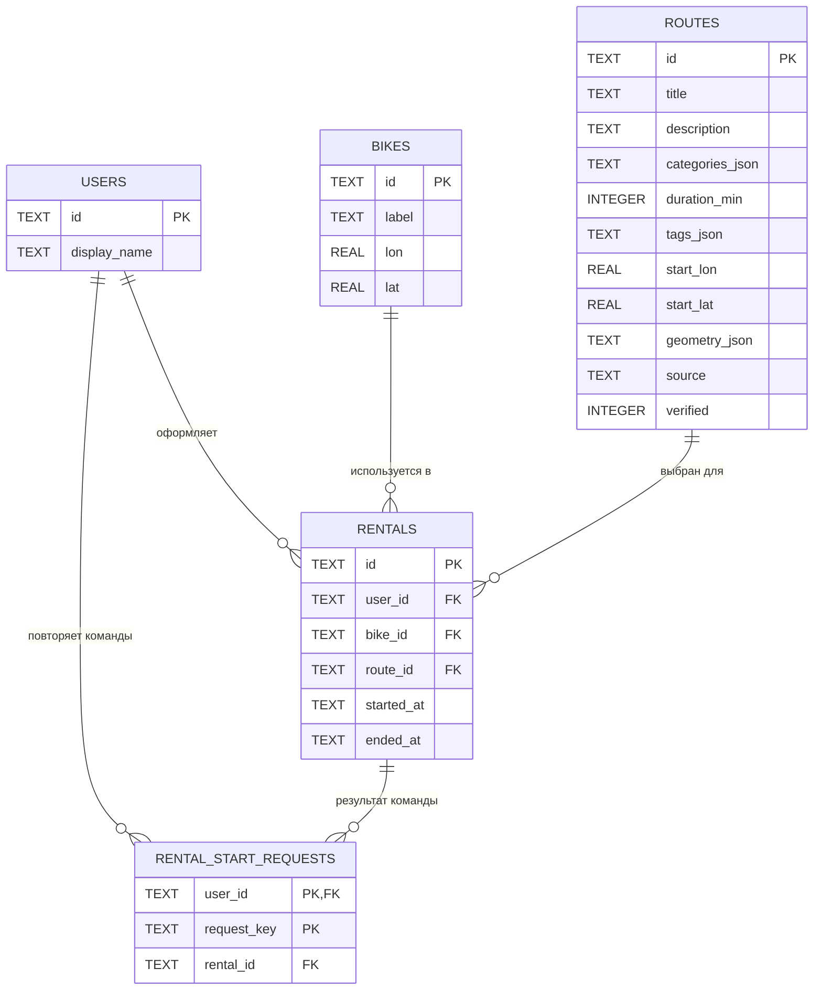

# Backend: сценарии, данные и API

## Варианты использования

Аутентификация и регистрация в текущей версии не реализованы. Все запросы аренды работают с общей записью пользователя `demo`, поэтому клиенты одного стенда разделяют состояние активной аренды.

Основной пользовательский поток:

1. Клиент получает список маршрутов с фильтрами и выбирает подходящий.
2. Клиент загружает полную карточку выбранного маршрута, включая геометрию.
3. Просмотр маршрута не создаёт аренду. При желании пользователь получает велосипеды и начинает аренду, передав маршрут и UUID-заголовок `Idempotency-Key`.
4. Активная аренда восстанавливается запросом `GET /api/rental`; завершение выполняется отдельной командой.

## Архитектура данных

Схема физически реализована в `backend/schema.sql`. Для `rentals` действуют частичные уникальные индексы: у пользователя может быть не более одной активной аренды, и один велосипед не может одновременно участвовать более чем в одной активной аренде. Завершённая аренда сохраняется в истории с `ended_at`.

Таблица `rental_start_requests` хранит ключ идемпотентности в пределах пользователя и ссылку на результат. Повтор команды с тем же ключом и теми же `bike_id`/`route_id` возвращает ранее созданную аренду; повторное использование ключа с другим содержимым даёт `409 IDEMPOTENCY_CONFLICT`.

При первом запуске БД создаёт схему версии 1 и добавляет начальные демонстрационные записи из `backend/seed.json`. Путь к файлу задаётся `PUT_DB_PATH`, значение по умолчанию — `put.sqlite` в текущем рабочем каталоге.

## Документация API

### Сводка методов

| Метод и путь | Назначение | Успешный ответ |
|---|---|---|
| `GET /healthz` | Проверить, что процесс отвечает | `200`, `{"status":"ok"}` |
| `GET /readyz` | Проверить готовность схемы и начального пользователя в БД | `200` ready или `503` |
| `GET /api/routes` | Получить отфильтрованные карточки маршрутов | `200`, массив карточек без геометрии |
| `GET /api/routes/{id}` | Получить подробности маршрута | `200`, объект маршрута с геометрией |
| `GET /api/bikes` | Получить список велосипедов и их доступность | `200`, массив велосипедов |
| `GET /api/rental` | Получить активную аренду пользователя `demo` | `200`, объект аренды или `null` |
| `POST /api/rental` | Начать аренду велосипеда для маршрута | `201` при создании, `200` при идемпотентном повторе |
| `POST /api/rental/finish` | Завершить аренду | `204 No Content` |

### Сводка значений ошибок

| HTTP-код | Код ошибки | Причина |
|---|---|---|
| `404` | `NOT_FOUND` | Не найдена запись маршрута, велосипеда или аренды |
| `409` | `RENTAL_ACTIVE` | У пользователя уже есть другая активная аренда |
| `409` | `BIKE_BUSY` | Велосипед занят другой активной арендой |
| `409` | `IDEMPOTENCY_CONFLICT` | Ключ идемпотентности ранее использован с другими данными |
| `422` | `VALIDATION` | Неверные параметры, UUID, фильтр или JSON-тело |
| `503` | `DB_UNAVAILABLE` | База данных недоступна или не готова |
| `500` | `INTERNAL` | Необработанная внутренняя ошибка запроса |
